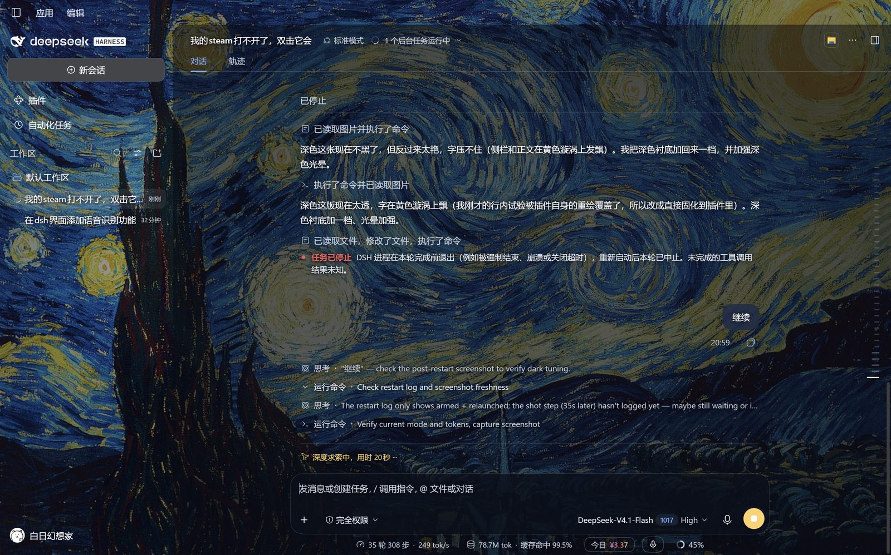
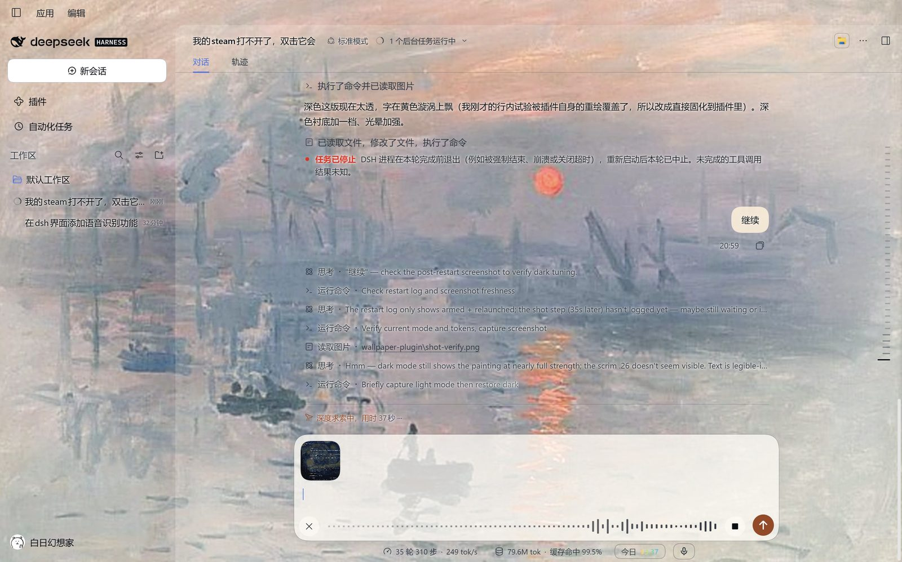

# DSH Wallpaper Skill

Turn any picture into the DeepSeek Harness interface wallpaper — full-bleed, theme-aware, and readable over paint.

把一个插件 + 一套流程打包成 skill：**丢一张图给 agent，界面背景就换成它**。深色/浅色各一张，令牌按明暗自动切换。




## 它解决什么问题

把画当界面背景，难点从来不是“铺上去”，而是这四件事：

1. DSH 的内容安全策略只放行 `'self'` 和 `data:`，从本地 HTTP 服务取图**必被拦**；
2. 应用壳、侧栏、正文列、聊天根节点**各自铺一层背景**，漏一层壁纸就被盖住；
3. 设计令牌有 `--dsw-alias-*` 和 `--dsw-specific-*` **两套命名空间**，漏一套就冒纯白块（输入框默认就是 `#fff`）；
4. 铺上去之后文字压在画上，直接加磨砂或白纱会立刻“浮”起来。

这个仓库把上面每一条都固化成了脚本和注释。

## 安装

技能目录（任选其一，DSH 按顺序扫描）：

| 作用域 | 路径 |
|---|---|
| 用户级（所有工作区可用） | `%DSH_HOME%\skills\wallpaper-from-image` |
| 项目级 | `<项目根>\.dsh\skills\wallpaper-from-image` |

```powershell
git clone https://github.com/<you>/dsh-wallpaper-skill "$env:DSH_HOME\skills\wallpaper-from-image"
```

重启 DSH 后，技能列表里会出现 `wallpaper-from-image`。

## 用法

对 agent 说：

> 把这张图做成界面壁纸

或者手动两步：

```powershell
$py = Join-Path $env:DSH_HOME 'dsh-runtimes\dsh-primary-runtime\dependencies\python\python.exe'
$env:PYTHONPATH = Join-Path $env:DSH_HOME 'dsh-runtimes\dsh-primary-runtime\dependencies\python\Lib\site-packages'

# 1) 处理：深色一张、浅色一张
& $py scripts\make_wallpaper.py --src "D:\pics\starry-night.jpg" --out "$env:DSH_HOME\wallpapers" --mode dark  --name dark  --brightness 1.0 --vignette 0.18
& $py scripts\make_wallpaper.py --src "D:\pics\sunrise.jpg"     --out "$env:DSH_HOME\wallpapers" --mode light --name light --brightness 1.05 --color 1.45 --warmth 0.10 --vignette 0.4

# 2) 内嵌 + 部署（会在 profile 里补注册项）
powershell -NoProfile -ExecutionPolicy Bypass -File scripts\deploy.ps1 -Light "$env:DSH_HOME\wallpapers\embed-light.jpg" -Dark "$env:DSH_HOME\wallpapers\embed-dark.jpg"
```

然后重启 DSH。

## 参数

| 参数 | 说明 |
|---|---|
| `--mode dark\|light` | 决定压边颜色与内嵌图命名，不影响其它逻辑 |
| `--brightness` | 0.65–1.05 常用；深色背景别低于 0.6，会闷 |
| `--color` | 彩度，1.1–1.55 |
| `--contrast` | 默认 1.02，强烈对比的图可降到 0.95 |
| `--warmth` | 0.10 左右明显偏暖，仅浅色模式常用 |
| `--vignette` | 边缘压暗/压白强度，0.15–0.45 |
| `--crop-bottom` | 裁掉底部比例，用来去图库水印（如 `0.09`） |
| `--quality` | 内嵌 JPEG 质量，默认 78；越大插件体积越大 |

## 目录

```
SKILL.md                 技能本体（agent 读这个）
scripts/make_wallpaper.py 图片处理：cover 裁切、调色、压边、导出全尺寸 + 内嵌图
scripts/deploy.ps1        写入 data URI、语法检查、部署到 profile、补注册项
scripts/cdp*.cjs          调试端口三件套：截图 / 执行 JS / 模拟悬停
plugin/                   wallpaper 插件模板（client.template.js 带 __LIGHT__/__DARK__ 占位符）
examples/                 效果图
```

## 已知坑

- 在 DSH 插件市场安装插件会重跑 pnpm，把没写进 profile `dependencies` 的自建插件当多余目录删掉。部署后把 `@local/dsh-wallpaper` 以 `"file:<源码目录>"` 写进 `package.json` 可以避免。
- 类名带哈希前缀（`BynINW_sidebarCol`），CSS 只匹配后缀 `[class*="_sidebarCol"]`，应用升级后也不至于全失效。
- 生成的 `client.js` 有 1–2 MB（两张 2000px 图 base64），属正常。
- 想彻底恢复原厂：删掉 `node_modules/@local/dsh-wallpaper` 和 `cordis.patch.yml` 里对应的 `- insert:` 段，重启。

## License

MIT
